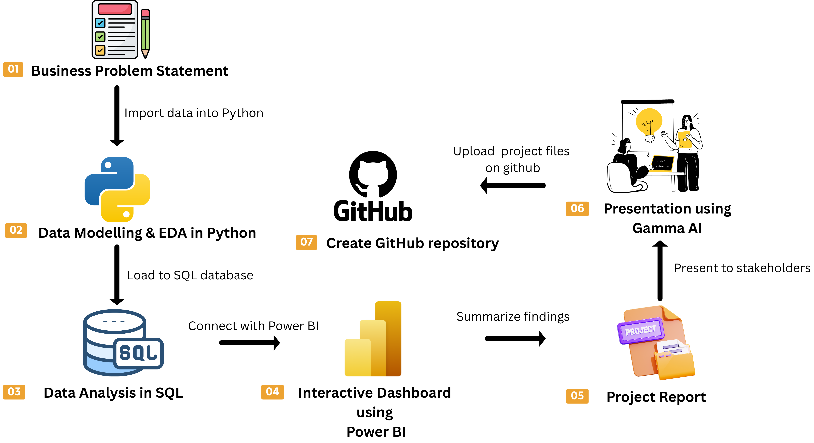

# 📊 Customer Shopping Behavior Analysis

An end-to-end data analytics project focused on understanding retail customer purchasing patterns using **Python, PostgreSQL, SQL, and Power BI**.

##  Objectives

- Clean and explore customer shopping data using Python.
- Analyze customer spending, product categories, discounts, and shopping preferences using SQL.
- Build an interactive Power BI dashboard to visualize key business metrics.
- Translate analytical findings into actionable business recommendations.

##  Tech Stack

- **Python:** Pandas, NumPy, Matplotlib, Seaborn
- **SQL:** PostgreSQL, aggregations, joins, and analytical queries
- **Database Tools:** pgAdmin 4, SQLAlchemy
- **Visualization:** Power BI
- **Environment:** Jupyter Notebook

##  Project Workflow



1. **Data Preparation:** Load, inspect, and clean the dataset using Python.
2. **Exploratory Data Analysis:** Examine customer demographics and purchasing patterns.
3. **SQL Analysis:** Investigate revenue, customer spending, discounts, and product performance.
4. **Dashboard Development:** Visualize key metrics and comparisons using Power BI.
5. **Business Insights:** Interpret results and develop data-driven recommendations.

## 📁 Project Files

| File | Description |
|---|---|
| `Customer_Shopping_Behavior_Analysis.ipynb` | Python data cleaning and exploratory analysis |
| `customer_behavior_sql_queries.sql` | SQL business analysis queries |
| `customer_shopping_behavior.csv` | Customer shopping dataset |
| `customer_behavior_dashboard.pbix` | Interactive Power BI dashboard |
| `Business Problem Document.pdf` | Business problem statement |

##  Getting Started

1. Download or clone this repository.
2. Install Python dependencies:

   ```bash
   pip install pandas numpy matplotlib seaborn sqlalchemy psycopg2-binary
   ```

3. Open the Jupyter Notebook and update the dataset path if necessary.
4. Create a PostgreSQL database named `customer_behavior`.
5. Configure your local database connection and run the notebook cells.
6. Execute the SQL queries in pgAdmin.
7. Open the Power BI file in Power BI Desktop and configure the data connection if required.

**Note:** Never commit database passwords or other credentials to GitHub.


## Author

**Sarthak Gupta**

Aspiring Data Analyst | Python | SQL | Power BI

